# LMS Student Enrollment Dashboard (Power BI)

A Power BI report analysing a learning management system (LMS): who is enrolled in what, how they perform, and how courses compare. It is built from three Excel tables (Students, Courses, Enrollments) joined in a star-schema data model.

**Author:** Amandi Delight Chukwuebuka

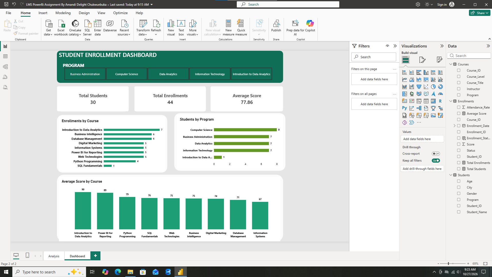

## Key metrics

| Total Students | Total Enrollments | Average Score | Pass rate |
|:---:|:---:|:---:|:---:|
| 30 | 44 | 77.86 | 95.5% (42 of 44) |

## Business questions

1. Which courses attract the most enrollments?
2. How do students perform in each course?
3. Which programs do students come from?
4. How are scores related to attendance?

## Report pages

**1. Analysis** is a working page with KPI cards, a detail table of every enrollment (student, course, status, date), enrollments and average score by course, and a donut of students by program.

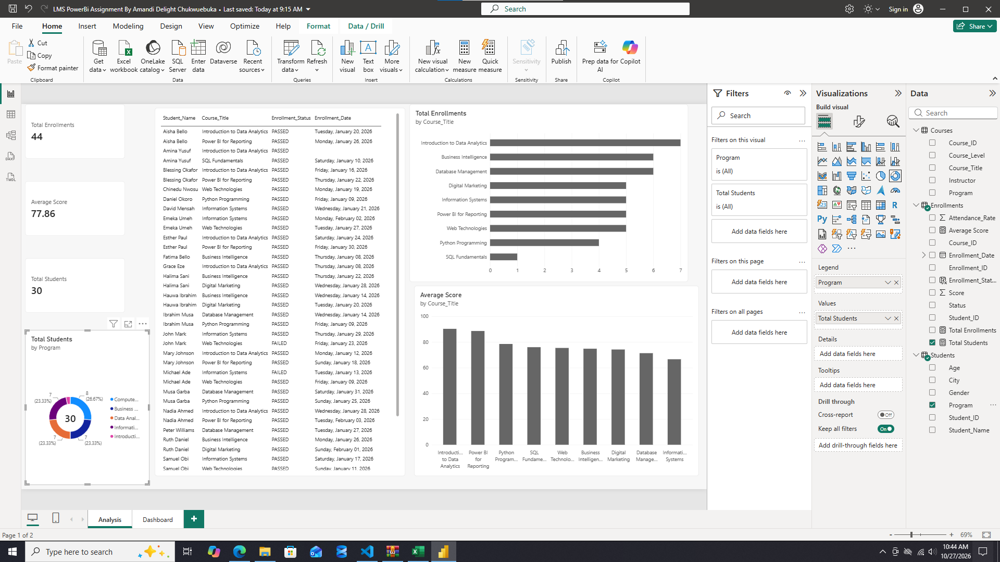

**2. Dashboard** is the presentation page, titled *Student Enrollment Dashboard*. It has a Program filter, three KPI cards (Total Students, Total Enrollments, Average Score), and charts for Enrollments by Course, Students by Program and Average Score by Course.

## Data model

Enrollments is the fact table. Courses and Students are dimension tables, each linked to Enrollments by a one-to-many relationship on `Course_ID` and `Student_ID`.

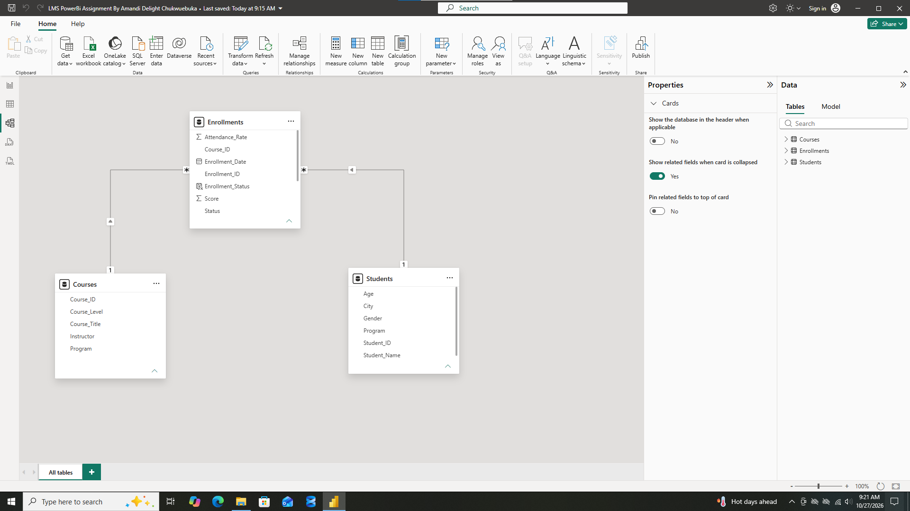

| Table | Rows (raw) | Key columns |
|-------|-----------:|-------------|
| Students | 30 | Student_ID, Student_Name, Gender, Age, City, Program |
| Courses | 10 | Course_ID, Course_Name, Department, Instructor, Course_Level |
| Enrollments | 52 | Enrollment_ID, Student_ID, Course_ID, Enrollment_Date, Score, Attendance_Rate, Status |

Measures and calculated fields in the report: **Total Students**, **Total Enrollments**, **Average Score** and an **Enrollment_Status** column. Course_Name is shown as Course_Title and the course Department as Program.

## Data cleaning

The raw files had data quality problems. After preparation the report shows 44 enrollments and 30 students, and `src/prepare_data.py` reproduces this from the raw files, including the average score of 77.86.

| Issue in the raw data | Fix |
|-----------------------|-----|
| 2 exact duplicate enrollment rows (EN047, EN048) | Removed |
| 6 enrollments with no Enrollment_ID | Removed (52 rows become 44) |
| 5 students with no Student_ID | Restored from the ST001 to ST030 sequence |
| Missing Gender (1), City (3) and Program (1) for students | Set to "Unknown" |
| 2 enrollments with no Student_ID | Kept, but they cannot be linked to a student |
| 1 enrollment with no Enrollment_Date, 1 with no Score | Left blank, so the average ignores the missing score |
| 2 enrollments with no Status | Status derived from Score (60 or above is Passed) |

## Insights

- **Introduction to Data Analytics is the most popular course** with 7 enrollments, and also has the highest average score (90). Power BI for Reporting is next at 88.6 (5 enrollments).
- **Information Systems has the lowest average score** (66.6), followed by Database Management (71.3).
- **Attendance and score move together.** The correlation is very strong (r = 0.92), and the two failed enrollments are both at the low-attendance end (70% and 76%).
- **Data Analytics is the largest program** by enrollments (12 of 44). Every enrollment that can be linked to a student is in a course from that student's own program.
- **Coverage gaps:** SQL Fundamentals has only 1 enrollment, Data Visualization has none, and 5 of the 30 students (ST026 to ST030) have no enrollments.
- **Overall performance is strong.** The average score is 77.86 and only 2 of 44 enrollments failed (Information Systems and Web Technologies).
- **Beginner and Intermediate courses score alike** (78.5 vs 77.2 on average).

## Known issue to fix in the .pbix

In the report's Students by Program chart and the Program filter, one student (Grace Eze) appears under **"Introduction to Data Analytics"**, which is a course title and not a program. Her Program is blank in the source file, and it was filled with the wrong value. The charts below show it as "Unknown" instead.

## More visuals

Charts generated with Python from the cleaned data (`python src/visuals.py`).

### Courses
| | |
|:---:|:---:|
| 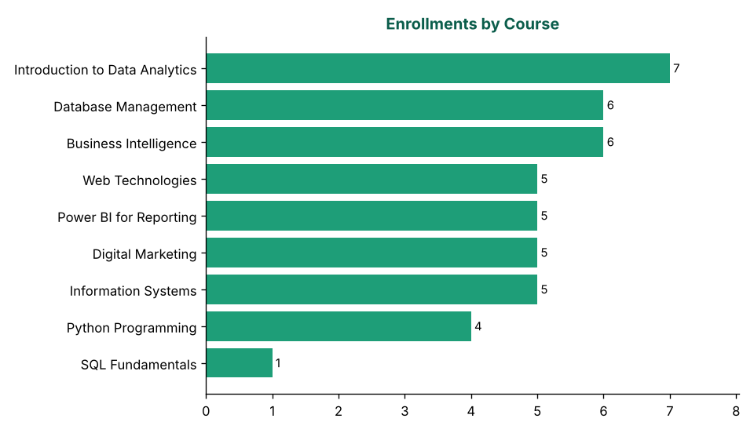 | 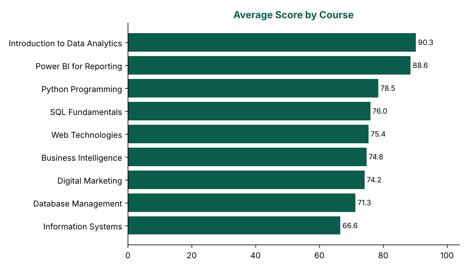 |
| 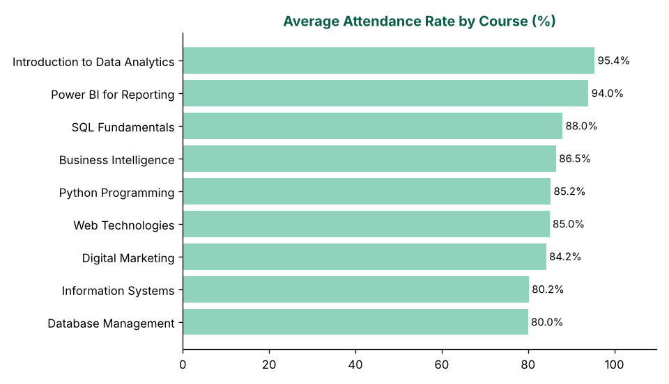 | 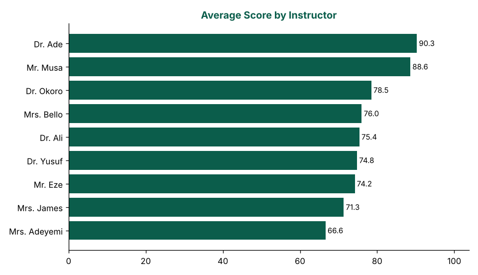 |
| 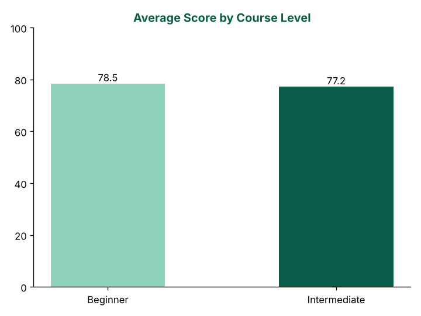 | 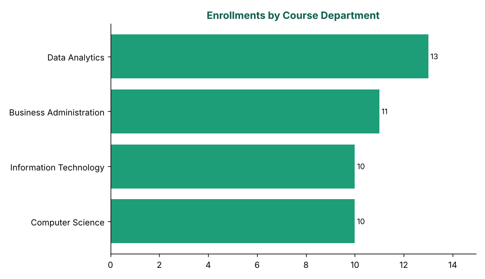 |

### Performance
| | |
|:---:|:---:|
| 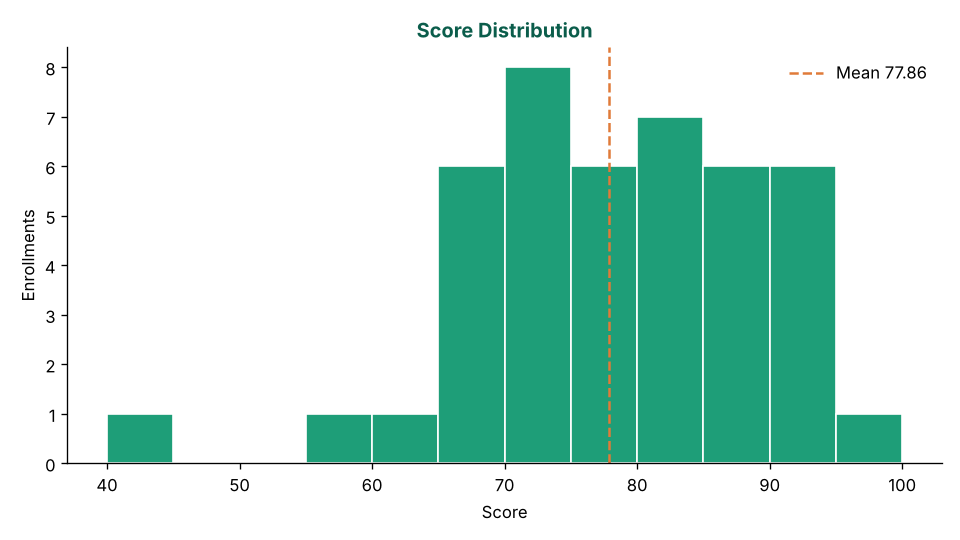 | 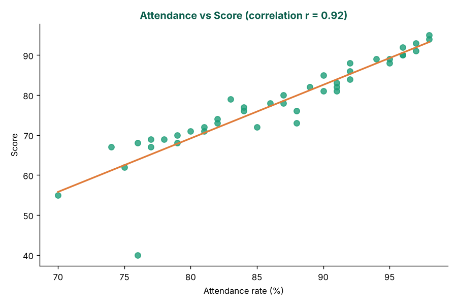 |
| 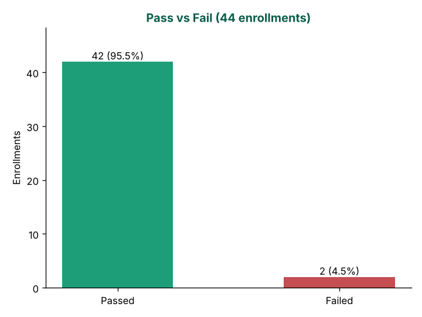 | 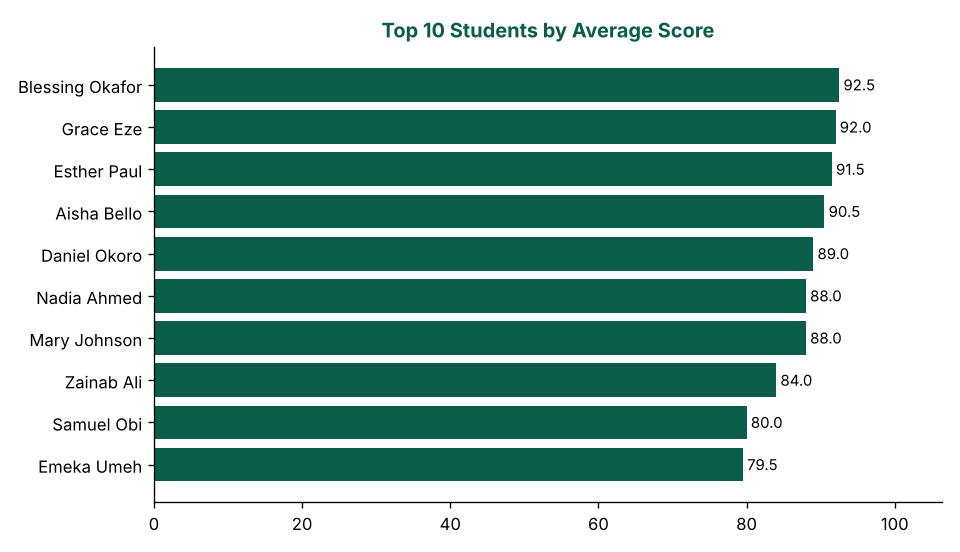 |

### Students
| | |
|:---:|:---:|
| 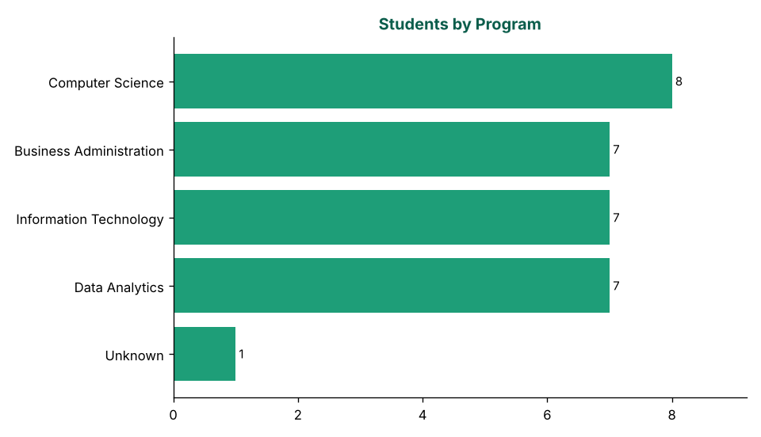 | 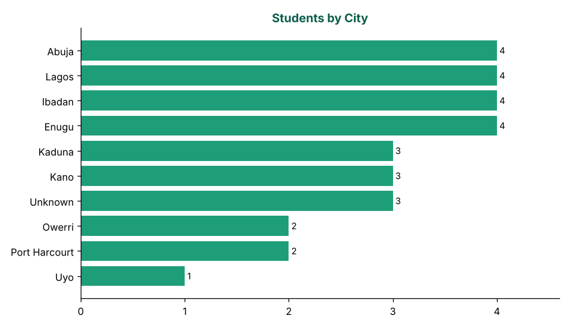 |
| 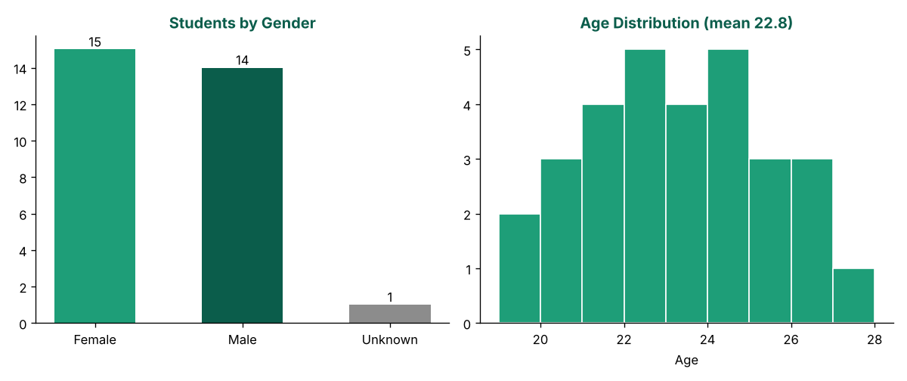 | 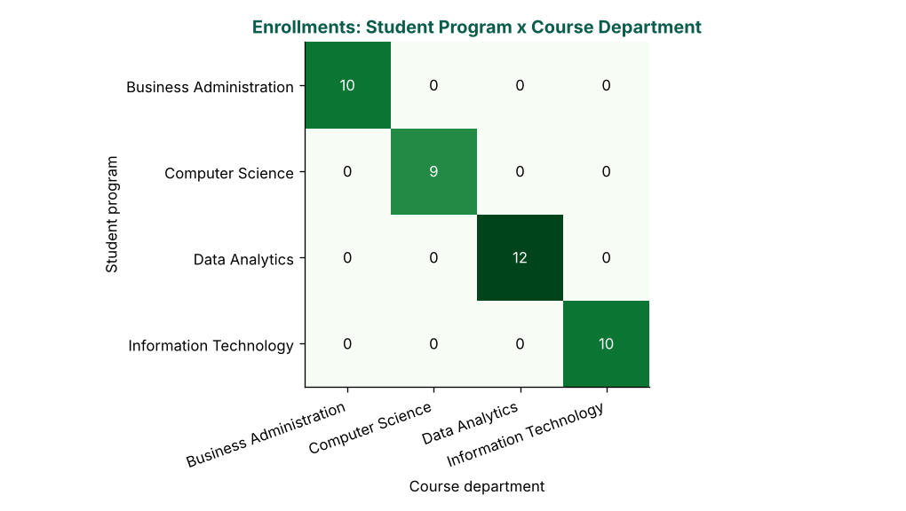 |
| 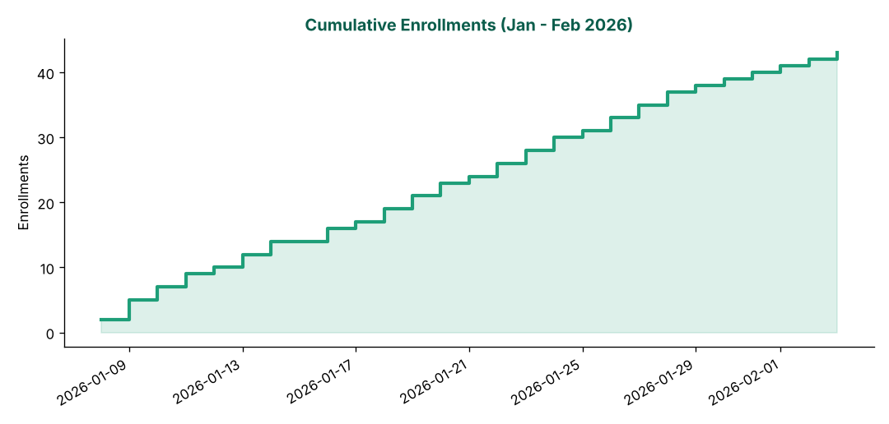 |  |

## Repository structure

```
lms-powerbi-dashboard/
├── powerbi/
│   └── LMS_PowerBI_Assignment.pbix   # the Power BI report
├── data/
│   ├── raw/                          # Students, Courses, Enrollments (Excel)
│   └── processed/                    # cleaned CSVs + joined analysis table
├── images/                           # report and model screenshots
├── visuals/                          # extra charts (PNG)
├── src/
│   ├── prepare_data.py               # cleaning script
│   └── visuals.py                    # chart script
├── requirements.txt
└── README.md
```

## How to use

1. Open `powerbi/LMS_PowerBI_Assignment.pbix` in Power BI Desktop. If it asks for the data source, point the three tables to the files in `data/raw/`.
2. Use the **Program** filter on the Dashboard page to slice every visual.
3. To rebuild the cleaned data and the extra charts:

```bash
pip install -r requirements.txt
python src/prepare_data.py
python src/visuals.py
```

## Tools

Power BI Desktop (Power Query, data modelling, DAX measures, report design) · Excel · Python (pandas, Matplotlib)
